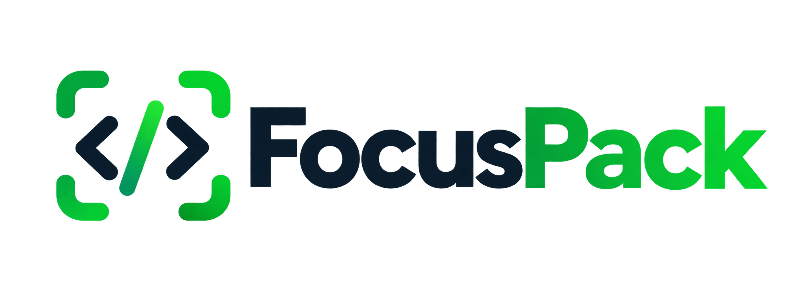

<div align="center">



<br/>

**Focus-driven, budget-aware codebase context packager for LLMs**

[](https://github.com/maqbulansari/focuspack/actions)
[](https://opensource.org/licenses/MIT)
[](https://www.python.org/downloads/)
[](https://github.com/astral-sh/ruff)
[](focuspack/py.typed)
[](SECURITY.md)

*Don't dump blindly. Pack the exact slice of code your LLM needs with AST contracts, semantic roles, and adaptive token budgets.*

[Quick Start](#-quick-start) • [Why focuspack?](#-why-focuspack) • [How Budgeting Works](#-adaptive-multi-stage-budget-engine) • [Comparison](#-competitive-comparison) • [Python SDK](#-programmatic-python-api) • [Benchmarks](#-empirical-benchmark--reproducibility) • [Security & Privacy](#-security--privacy) • [CLI Reference](#-cli-reference) • [Product Charter](CHARTER.md) • [Contributing](#-contributing)

---

</div>

## 💡 Why focuspack?

Static file dumpers (like Repomix or code2prompt) suffer from a fundamental blind spot: **they treat codebases as flat buckets of files**. If you run them on a project, they dump dozens of files into a 100k+ token monolith.

### The Attention Breakdown (Lost in the Middle)
Transformer research proves that as context length grows, reasoning accuracy plummets in the middle 60–80% of the prompt. Dumping 80 irrelevant files dilutes attention heads, causing missed edge cases, hallucinated methods, and sluggish completions.

### What LLMs Actually Need
1. **High Signal-to-Noise:** The file you are actively modifying in **FULL**.
2. **Contract-First Dependencies:** When an LLM calls helper functions or imports classes, it rarely needs hundreds of lines of internal implementation. It only needs the **interface contract** (class hierarchy, method signatures, argument types, return annotations, and docstrings).
3. **Adaptive Token Fitting:** When constrained by a token budget (e.g., `--budget 8k` or `--budget 32k`), context tools must intelligently tier and adapt code—**without sacrificing the target file you asked to inspect**.
4. **Semantic Role Labeling:** Tagging files with `role="focus_target"` vs `role="dependency_contract"` explicitly instructs the model what it is asked to modify versus what is an immutable external API.

---

## ⚡ Architectural Comparison

How `focuspack` differs from whole-repo flat dumpers:

| Dimension | Whole-Repo Packers (e.g. Repomix) | 🎯 focuspack |
| :--- | :--- | :--- |
| **Primary Goal** | Whole-repository packing for general ingestion | Focused task/file context with interface contracts |
| **Selection Model** | Flat glob patterns / entire repo dumps | Focus file (`-F`) with AST dependency traversal |
| **Dependency Context** | Flat inclusion or exclusion of whole files | Imports extracted as AST interface skeletons |
| **Budget Enforcement** | File truncation or exit threshold checks | 5-stage adaptive tiering on total rendered output |
| **Secret Sanitization** | Whole-file exclusion (e.g. Secretlint) | In-place secret masking (preserves AST and imports) |
| **Output Semantic Roles** | Flat file tags | Explicit roles (`focus_target` vs `dependency_contract`) |
| **Task / Mission Framing** | Generic code dump | Prompt templates (`--task bugfix\|review\|refactor`) |
| **Ecosystem & Runtime** | Broad multi-language (Tree-sitter), Node.js runtime | Pure Python (`pip`, `uvx`), zero Node.js/C runtime |


---

## 🧠 Adaptive Multi-Stage Budget Engine

When you supply `--budget <size>` (e.g. `--budget 8k` or `--budget 32k`), `focuspack` does **not** naively truncate text, omit the envelope, or silently drop your primary target. It optimizes the **entire rendered output** (manifest, tree, envelope tags, and code contents) across a 5-stage adaptive pipeline:

```
[All Repo Files]
       │
       ▼  Stage 1: Peripheral Pruning
[Focus Target (FULL) + Contracts (FULL)]
       │
       ▼  Stage 2: Contract Skeletonization
[Focus Target (FULL) + Contracts (AST Skeletons)]
       │
       ▼  Stage 3: Contract Docstring Stripping (AST Transformer)
[Focus Target (FULL) + Contracts (Minimal AST)]
       │
       ▼  Stage 4: Target Method Body Compression (AST)
[Focus Target (Signatures + Compressed Methods) + Contracts]
       │
       ▼  Stage 5: Dependency Contract Pruning (Lowest-Ranked First)
[Focus Target (Preserved) + Essential Contracts (Strict Fit)]
       │
       ▼  (Optional: --strict-budget)
[Guaranteed Fit or Non-Zero Exit Code]
```

1. **Stage 1 — Peripheral Pruning:** Unrelated modules, documentation files (`README.md`, `LICENSE`), and peripheral assets are omitted from file contents while preserving repository architecture in the directory tree.
2. **Stage 2 — Dependency Contract Skeletons:** Directly imported dependencies are converted into AST interface contracts. Method bodies are replaced with `...`, preserving class definitions, type hints, and docstrings.
3. **Stage 3 — Clean AST Docstring Stripping:** If further reduction is required, contract docstrings are cleanly removed using an `ast.NodeTransformer` without corrupting code or leaving loose strings.
4. **Stage 4 — Large Target Method Compression:** If the focus target alone exceeds the budget, verbose internal method bodies are compressed to `...` while preserving public interfaces, arguments, return types, and docstrings.
5. **Stage 5 — Ranked Contract Dropping:** If tight budgets cannot be satisfied by compression alone, lowest-ranked dependency contracts (furthest in depth, least referenced) are pruned one-by-one until the full rendered output strictly fits the requested token limit—without ever sacrificing your focus target.
6. **Strict Budget Mode (`--strict-budget`):** In CI/CD pipelines or automated workflows, `--strict-budget` guarantees an exit code `1` if even Stage 5 and aggressive target compression cannot satisfy the requested limit. Token counts evaluate the whole rendered payload (manifest, tree, envelope, and contents).

---

## 🚀 Quick Start

### Installation

```bash
# Recommended: Install with tiktoken for exact BPE cl100k token counts (Claude, GPT-4o, Gemini)
pip install "focuspack[tiktoken]"

# Standard install (includes calibrated fallback estimator)
pip install focuspack

# Or run instantly with uvx / pipx without installing
uvx focuspack
```

> **Note on Token Counting:** For production pipelines and strict budget gating, installing `focuspack[tiktoken]` ensures token measurements precisely match Anthropic Claude 3.5/3.7, OpenAI GPT-4o, and Gemini tokenizers.

### Common Workflows

```bash
# 1. Target a specific file — packages auth.py in FULL and its imported dependencies as Skeletons:
focuspack --focus src/auth/service.py

# 2. Fit adaptively within an 8k or 32k token window:
focuspack -F src/auth/service.py --budget 8k

# 3. Add an automated debugging mission and copy straight to clipboard:
focuspack -F src/payment.py --task bugfix --copy

# 4. Package git-modified files + their connected contracts:
focuspack diff --copy

# 5. Enforce strict budget gating in CI scripts:
focuspack -F src/api.py --budget 16k --strict-budget
```

---

## 📦 Output Format (Claude & LLM Optimized)

By default, `focuspack` generates semantic XML structured for Anthropic Claude 3.5/3.7, OpenAI GPT-4o, and Google Gemini:

```xml
<documents>
  <context_manifest>
    <tool>focuspack v0.2.0</tool>
    <token_budget total_allowed="8000" tokens_used="6420" utilization="80.2%" status="fits"/>
    <role_counts focus_targets="1" dependency_contracts="3"/>
  </context_manifest>

  <directory_structure>
  src/
  ├── auth/
  │   └── service.py  [FOCUS]
  └── db/
      └── client.py   [CONTRACT]
  </directory_structure>

  <files>
    <file index="1" path="src/auth/service.py" role="focus_target" mode="full" tokens="3420">
      <document_content>
        <!-- Full implementation code of the focus target -->
      </document_content>
    </file>

    <file index="2" path="src/db/client.py" role="dependency_contract" mode="skeleton" tokens="380">
      <document_content>
        <!-- AST Contract: classes, methods, type hints, docstrings without bodies -->
      </document_content>
    </file>
  </files>

  <task_instruction>
    You are a principal debugging engineer. Analyze the enclosed focus targets and their dependency contracts...
  </task_instruction>
</documents>
```

*(Also supports `--format markdown`, `--format json`, and `--format plain`).*

---

## 🛡️ Security & Privacy

`focuspack` is engineered from the ground up for strict, zero-trust development environments:

### 1. In-Place Secret & Credential Redaction
Rather than dropping entire source files when credentials are detected, `focuspack` automatically scans and performs **in-place redaction** (`[REDACTED_SECRET: ...]`), preserving your code's syntactic structure, function signatures, and imports:
- **API Keys & Tokens:** OpenAI (`sk-...`), Anthropic (`sk-ant-...`), GitHub tokens (`ghp_...`, `github_pat_...`), Slack tokens.
- **Cloud Credentials:** AWS Access Keys (`AKIA...`), AWS Secret Keys.
- **Database Connection Strings:** Complete password redaction across `postgres://`, `mysql://`, `mongodb://`, `redis://`, and `mssql://` URLs (preserving host and port for structural context).
- **Private Keys:** RSA, SSH, and generic PEM private keys.

### 2. Zero Network Egress & Air-Gapped Operation
- **100% Offline Execution:** `focuspack` contains zero network calls, telemetry, or analytics tracking.
- **No LLM Proxying:** Does not send your code to external APIs or third-party servers; outputs deterministic local files for your direct inspection.

### 3. Safe Static Analysis
- **Zero Dynamic Execution:** Inspects code via Python standard library `ast.parse` without importing modules, calling `eval()`, or invoking untrusted binaries.
- **Data Minimization:** Context is strictly trimmed to the specified focus targets and interface contracts, omitting unrelated files.
- **Type-Check Certified:** PEP 561 compliant (`py.typed`) for static typing verification with Mypy and Pyright.

See our **[Security Policy (SECURITY.md)](SECURITY.md)** for vulnerability reporting procedures and architectural attestations.

---

## 📖 CLI Reference

```text
Usage: focuspack [OPTIONS] COMMAND [ARGS]...

Options:
  -v, --version  Show version and exit.
  --help         Show this message and exit.

Commands:
  pack     Package focused codebase context optimized for LLMs.
  analyze  Inspect repository dependency graph, token metrics, and largest files.
  diff     Package only git-changed files + their connected dependency contracts.
  init     Create a .focuspack.json configuration file.
```

### `focuspack pack` Options

| Option | Flag | Description | Default |
| :--- | :--- | :--- | :--- |
| `--focus` | `-F` | File(s) or directories to focus on (kept in Full; dependencies become Contracts) | `None` |
| `--depth` | `-d` | Dependency traversal depth (1 = direct imports, 2 = 2 hops) | `1` |
| `--budget` | `-b` | Token budget (e.g. `8k`, `32k`, `64k`). Adaptively tiers files to fit | `None` |
| `--strict-budget` | | Exit with non-zero error code if output exceeds requested budget | `False` |
| `--include-peripherals` | | Keep peripheral/unrelated files in output even when focus targets are active | `False` |
| `--task` | `-t` | Task prompt template (`bugfix`, `review`, `refactor`, `explain`, `test`) | `None` |
| `--format` | `-f` | Output format (`xml`, `markdown`, `json`, `plain`) | `xml` |
| `--mode` | `-m` | Compression mode (`auto`, `full`, `skeleton`) | `auto` |
| `--copy` | `-c` | Copy output directly to system clipboard | `False` |
| `--stdout` | | Stream output directly to stdout | `False` |
| `--diff` | | Focus on git uncommitted/staged changes + connected contracts | `False` |
| `--output` | `-o` | Output file path | `context.<format>` |
| `--no-redact-secrets` | | Disable automated secret redaction | `False` |
| `--tree / --no-tree` | | Include directory tree diagram | `True` |
| `--quiet` | `-q` | Suppress console UI | `False` |

---

## ⚙️ Configuration

Generate a configuration file with:

```bash
focuspack init
```

Creates `.focuspack.json`:

```json
{
  "output_format": "xml",
  "mode": "auto",
  "token_budget": 32000,
  "focus_depth": 1,
  "focus_targets": [],
  "max_size": "500kb",
  "exclude": [
    "docs/build/**",
    "scratch/**"
  ],
  "respect_gitignore": true,
  "redact_secrets": true,
  "include_tree": true
}
```

---

## 🐍 Programmatic Python API

`focuspack` is completely embeddable into autonomous agents (LangChain, LlamaIndex, AutoGen, CrewAI), FastAPI backends, or custom developer scripts:

```python
from focuspack.analyzer import Analyzer
from focuspack.collector import Collector
from focuspack.config import FocusPackConfig
from focuspack.formatter import Formatter

# 1. Configure focus target, depth, and token budget
config = FocusPackConfig(
    root_path=".",
    focus_targets=["services/payment_service.py"],
    focus_depth=1,
    token_budget=8000,
    output_format="xml",
    task_template="bugfix",
)

# 2. Collect files and build AST dependency graph
collector = Collector(config)
files = collector.collect()
stats = Analyzer.compute_stats(files)
file_tree = collector.build_file_tree(files)

# 3. Format into Claude / LLM-optimized context XML
context_xml = Formatter.format_all(
    files=files,
    stats=stats,
    file_tree=file_tree,
    fmt=config.output_format,
    budget_report=collector.budget_report,
    task_prompt=config.task_template,
)

print(context_xml)
```

---

## 🔬 Empirical Benchmark & Reproducibility

An automated reproducibility suite is included in [`scripts/benchmark.py`](scripts/benchmark.py) to independently verify token budget enforcement, target preservation, and contract pruning across real repositories (`requests`, `click`, `flask`):

```bash
# Run the empirical benchmark suite (requires tiktoken)
python scripts/benchmark.py
```

---

## 🤝 Contributing

Contributions, issues, and feature requests are welcome!
Please review our **[Product Charter (CHARTER.md)](CHARTER.md)** to ensure proposals align with our core mission, and see [CONTRIBUTING.md](CONTRIBUTING.md) for local dev setup.

1. Fork the repo & clone locally
2. Create your branch (`git checkout -b feature/awesome-feature`)
3. Install dependencies (`pip install -e ".[dev,all]"`)
4. Run tests (`pytest`)
5. Open a Pull Request verifying alignment with the Charter


---

## 📄 License

Distributed under the MIT License. See [LICENSE](LICENSE) for details.
